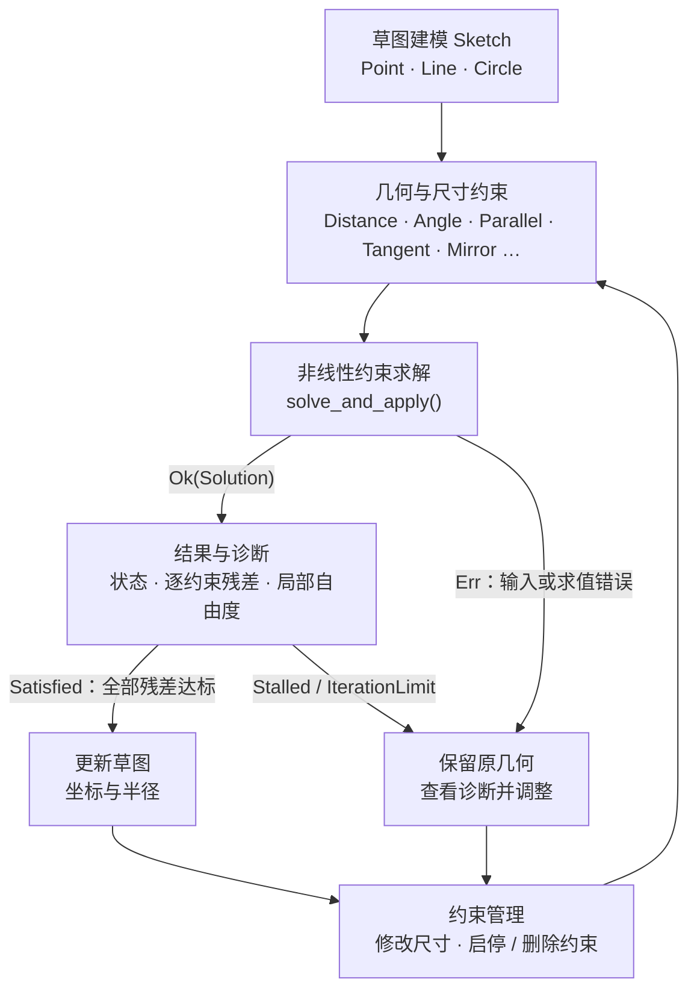

# MoonBit CAD Sketch

**Pure MoonBit 2D parametric sketch constraint solver.**

Define points, lines and circles, add geometric or dimensional constraints, solve the sketch, edit dimensions and solve again.

纯 MoonBit 二维参数化草图约束求解库，提供草图建模、24 种几何与尺寸关系、参数编辑和求解诊断。核心仅依赖 MoonBit core。

[GitHub 源码仓库](https://github.com/mik1e80/moonbit-cad-sketch) · [Mooncakes 包](https://mooncakes.io/docs/mik1e80/cad_sketch)

[快速开始](docs/QUICK_START.md) · [约束](docs/CONSTRAINTS.md) · [求解](docs/SOLVER.md) · [诊断](docs/DIAGNOSTICS.md) · [限制](docs/LIMITATIONS.md) · [示例](examples/README.md)

## 使用示例

[Mooncakes：mik1e80/cad_sketch@0.1.0](https://mooncakes.io/docs/mik1e80/cad_sketch)。需 `moonc >= 0.10.15`。在自己的 MoonBit 项目根目录安装：

```sh
moon add mik1e80/cad_sketch
```

在 `moon.pkg` 中导入 `"mik1e80/cad_sketch" @sketch`；完整语法、尺寸编辑及本地 workspace 见[快速开始](docs/QUICK_START.md)。

```moonbit
let sketch = @sketch.Sketch::new()
let a = sketch.add_point(0.0, 0.0)
let b = sketch.add_point(3.0, 0.5)
sketch.constrain(Fix(a, 0.0, 0.0)) |> ignore
sketch.constrain(Horizontal(sketch.add_line(a, b))) |> ignore
let length = sketch.constrain(Distance(a, b, 5.0))
match sketch.solve_and_apply() {
  Ok(solution) => println(solution.report.is_satisfied())
  Err(error) => println(error.message())
}
sketch.set_constraint(length, Distance(a, b, 7.0)) |> ignore
// 再次调用 solve_and_apply()，检查状态后读取几何。
```

只有 `Satisfied` 才会写回几何；`Stalled` / `IterationLimit` 不证明无解。可执行公开接口示例见 [README.mbt.md](README.mbt.md)。

## 文档导航

| 文档 | 内容 |
| --- | --- |
| [QUICK_START](docs/QUICK_START.md) | 安装、导入、建模与第一次编辑 |
| [CONSTRAINTS](docs/CONSTRAINTS.md) | 24 种关系、方向与单位约定 |
| [SOLVER](docs/SOLVER.md) | 求解、几何应用、状态与容差 |
| [DIAGNOSTICS](docs/DIAGNOSTICS.md) | 类型化错误、残差、自由度与冲突排查 |
| [LIMITATIONS](docs/LIMITATIONS.md) | 数值范围、规模、未实现功能与发布状态 |
| [ECOSYSTEM](docs/ECOSYSTEM.md) | 与优化、几何、布局、文件处理库的分工 |
| [VALIDATION](docs/VALIDATION.md) | 语料、独立判定、真实历史数据与复现 |
| [ARCHITECTURE](docs/ARCHITECTURE.md) | 内部建模、数值实现与验证方法 |

[API 总览](docs/API_GUIDE.md) · [约束生命周期](docs/CONSTRAINT_LIFECYCLE.md) · [项目定位](docs/POSITIONING.md) · [验收记录](docs/ACCEPTANCE.md) · [发布与安装验证](docs/PUBLISHING.md) · [Consumer Test](docs/CONSUMER_TEST.md)

## 示例目录

所有命令在仓库根目录执行。

| 案例 | 命令 | 展示内容 |
| --- | --- | --- |
| [basic](examples/basic/README.md) | `moon run examples/basic --target js` | 矩形改宽、三角形、相切圆 |
| [parametric_bracket](examples/parametric_bracket/README.md) | `moon run examples/parametric_bracket --target js` | 四孔安装板尺寸联动 |
| [mirror_holes](examples/mirror_holes/README.md) | `moon run examples/mirror_holes --target js` | 镜像孔位与轴移动 |
| [four_bar](examples/four_bar/README.md) | `moon run examples/four_bar --target js` | 连续角度驱动的机构位置求解 |
| [conflict](examples/conflict/README.md) | `moon run examples/conflict --target js` | 冲突诊断、几何保留、停用与删除恢复 |

## Parametric Bracket Demo

同一个草图将板宽 120→160、孔半径 5→8、水平孔心边距 20→30，孔位通过镜像、等半径和边距关系自动联动。[建模与复现](examples/parametric_bracket/README.md)。


## Four-bar linkage

固定 A、D，保持 AB=30、BC=70、CD=50，仅修改角度约束，往返求解 25 个姿态。[参数、分支与复现](examples/four_bar/README.md)。


## 能力图

从几何草图建模、约束定义，到尺寸编辑后的重新求解：



建模层管理点、线、圆和约束；求解层返回候选几何与诊断。`solve()` 仅返回结果，图中的 `solve_and_apply()` 在全部残差达标时更新草图。

`Satisfied` 表示残差达标，仍可能存在局部自由度。`local_dof` 是当前构型的一阶数值估计；`Stalled` / `IterationLimit` 不证明无解，未满足约束列表也不是最小冲突集。

## Validation Suite

已记录的历史证据包括四后端各 400 个生成配置、JS 的 1000 个随机三角形初值和 500 个 SciPy 开发参考对照。数据对应各自保存的源码指纹；本次目录整理仅做轻量检查，未重测这些实验。

[验证方法与逐例数据](docs/VALIDATION.md) · [随机初值实验](docs/RANDOM_TRIANGLE.md) · [SciPy 对照](docs/SCIPY_REFERENCE.md)

## Benchmark

JS release 实测，同一种相连三角化折线模型；每档预热一次、从相同初值求解三次：

| Case | Points | Vars | Constraints | Iterations | Status | 最大长度残差 |
| --- | ---: | ---: | ---: | ---: | --- | ---: |
| Small | 10 | 20 | 20 | 4 | Satisfied，3/3 | 7.77e-10 |
| Medium | 30 | 60 | 60 | 6 | Satisfied，3/3 | 1.18e-8 |
| Large | 60 | 120 | 120 | 8 | Satisfied，3/3 | 5.49e-9 |
| Stress | 100 | 200 | 200 | 8 | Satisfied，3/3 | 7.17e-8 |

[Benchmark 方法、机器环境、耗时与逐次数据](docs/BENCHMARK.md)明确了计时范围和模型边界。这些是固定模型的重复测量，不代表任意同规模草图的成功率或跨电脑性能。

日常轻量复现：`node scripts/benchmark.cjs --smoke --target js`。

## 仓库结构

```text
README.md
docs/
  QUICK_START.md
  CONSTRAINTS.md
  SOLVER.md
  DIAGNOSTICS.md
  LIMITATIONS.md
  ECOSYSTEM.md
  VALIDATION.md
  ARCHITECTURE.md
examples/
  basic/
  parametric_bracket/
  mirror_holes/
  four_bar/
  conflict/
```

`cmd/` 保留开发验证生成器与进阶编辑检查，`bench/` 保存规模测量程序；公开示例统一从 `examples/` 进入。

## 许可与来源

Apache-2.0，完整条款见 [LICENSE](LICENSE)。参考出处、许可证及使用范围见 [THIRD_PARTY_NOTICES.md](THIRD_PARTY_NOTICES.md)。本库面向小型二维草图，功能与数值边界见 [LIMITATIONS](docs/LIMITATIONS.md)。
