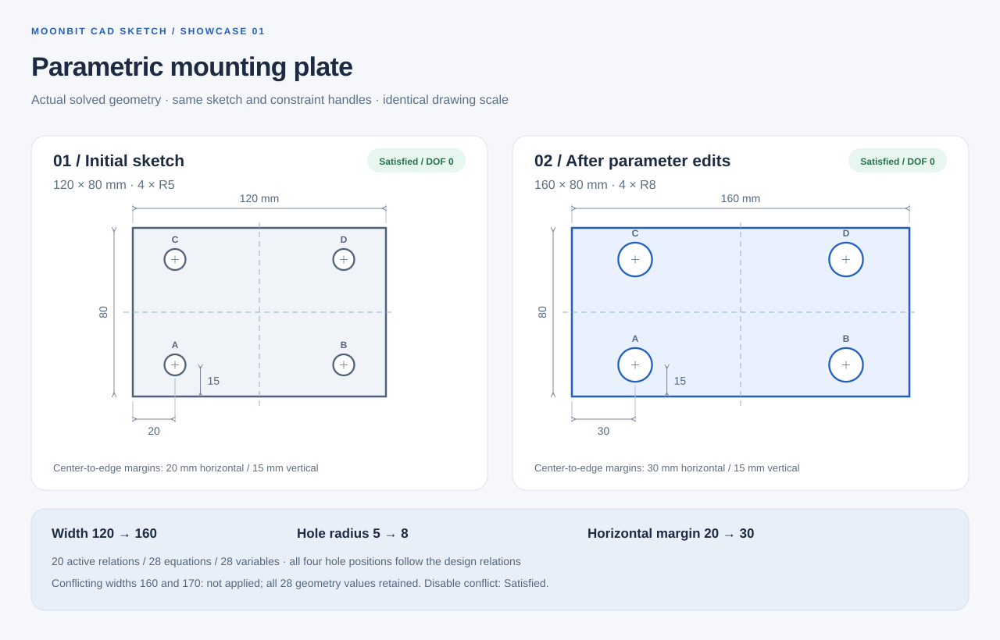
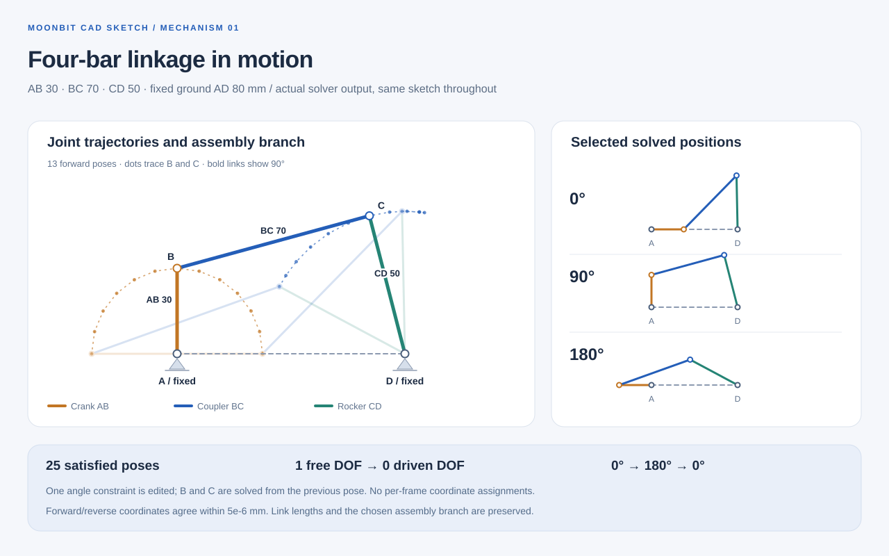
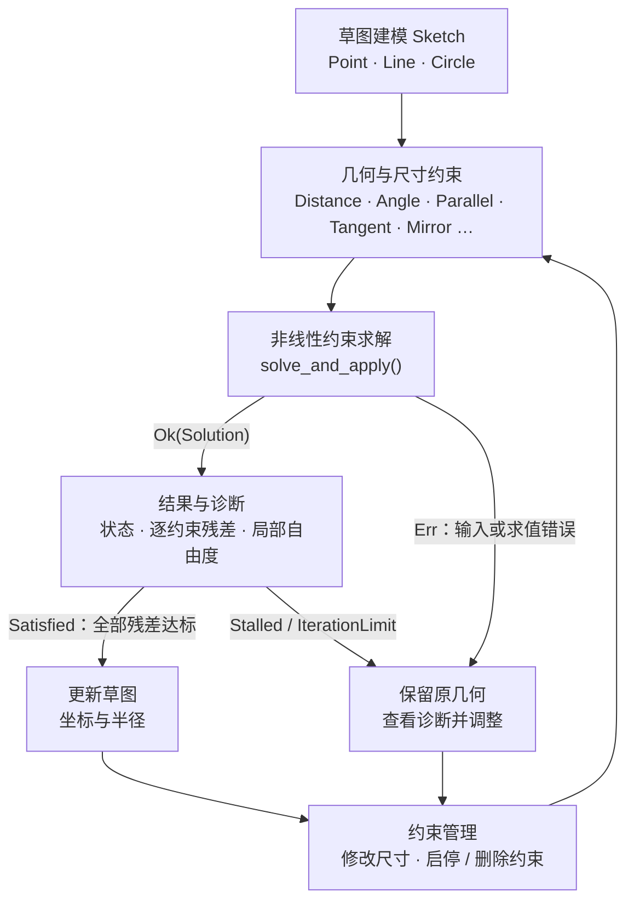

# MoonBit CAD Sketch

**Pure MoonBit 2D parametric sketch constraint solver.**

Define points, lines and circles, add geometric or dimensional constraints, solve the sketch, edit dimensions and solve again.

纯 MoonBit 的二维参数化草图约束求解库。定义点、线和圆，添加几何或尺寸约束，求解草图；修改尺寸后再次求解。

[安装板案例](#parametric-bracket-demo) · [四杆机构](#four-bar-linkage) · [能力图](#能力图) · [使用示例](#使用示例) · [项目定位与范围](docs/POSITIONING.md) · [技术说明](docs/ARCHITECTURE.md) · [生态对比](docs/ECOSYSTEM.md)

## Parametric Bracket Demo

用同一个草图建立 120×80 的四孔安装板，再将板宽 120→160、孔半径 5→8、水平孔心边距 20→30。四孔位置由镜像、等半径和孔心到板边的距离关系共同确定；每次编辑只修改尺寸约束。



```sh
moon run cmd/bracket_demo
node scripts/bracket_showcase.cjs --check
```

首条命令验证六个阶段并输出 JSON Lines；第二条需要 Node.js 18+，独立核对实际坐标并检查 SVG。案例还启用互相矛盾的宽度 160 与 170，验证失败时几何不变，关闭冲突后恢复。参数、建模关系、孔位结果及复现步骤见 [安装板案例说明](docs/SHOWCASE.md)。

## Four-bar linkage

固定 A=(0,0)、D=(80,0)，保持 AB=30、BC=70、CD=50；只修改 AB 相对 AD 的角度，以 15° 步长从 0° 连续求解到 180°，再返回 0°。同一草图共生成 25 个姿态，B、C 由上一成功构型继续求解。



```sh
moon run examples/four_bar
node scripts/four_bar_showcase.cjs --check
```

案例核对杆长、固定支点、装配分支、往返一致性，以及关闭 / 启用角度驱动时 1→0 的局部自由度变化，并输出完整 JSON 与 CSV。[机构建模与复现说明](examples/four_bar/README.md)介绍了参数选择和独立解析校验；这是运动学位置序列，未包含动力学或碰撞求解。

## 能力图

从几何草图建模、约束定义，到尺寸编辑后的重新求解：



建模层管理点、线、圆和约束；求解层返回候选几何与诊断。`solve()` 仅返回结果，图中的 `solve_and_apply()` 在全部残差达标时更新草图。

`Satisfied` 表示残差达标，仍可能存在局部自由度。`local_dof` 是当前构型的一阶数值估计；`Stalled` / `IterationLimit` 不证明无解，未满足约束列表也不是最小冲突集。


## 当前版本

第一版源码版本 `0.1.0`，尚未发布到 Mooncakes。仓库：<https://github.com/mik1e80/MoonBit-CAD->。模块名：`mik1e80/cad_sketch`。

工具链要求：`moonc >= 0.10.15`，已在 `moon 0.1.20261012` / `moonc 0.10.15+943464bfa` 上验证。源码采用新版 `Int32` 与带默认值的标记参数语法；旧版 0.10.14 需要先更新工具链。

```sh
git clone https://github.com/mik1e80/MoonBit-CAD-.git
cd MoonBit-CAD-
moon test
moon run cmd/demo
```

`cmd/demo` 实际求解 10×6 矩形，将宽度改成 15 后再次求解，再演示 3-4-5 三角形、两圆外切以及互相矛盾的坐标约束。

`moon run cmd/mirror_demo` 验证等半径镜像孔位：将对称轴从 `x=10` 移到 `x=12`，检查右孔中心从 `(14,3)` 移到 `(18,3)`，再验证冲突编辑不改变几何。

`moon run cmd/edit_demo` 演示中心对称、带符号偏移、长度比例和内切圆组成的完整草图。程序检查解析坐标，启用冲突关系后确认失败不改变几何，再关闭冲突并修改尺寸继续求解；结果不符会以非零状态退出，CI 在 wasm 与 JS 上运行。

## 使用示例

在使用者的 `moon.pkg` 中导入：

```moonbit
import {
  "mik1e80/cad_sketch" @sketch,
}
```

下面这段示例也作为公开接口测试运行，完整版本见 [README.mbt.md](README.mbt.md)。

```moonbit
let s = @sketch.Sketch::new()
let a = s.add_point(0.0, 0.0)
let b = s.add_point(3.0, 0.5)
let line = s.add_line(a, b)
s.constrain(Fix(a, 0.0, 0.0)) |> ignore
s.constrain(Horizontal(line)) |> ignore
let dimension = s.constrain(Distance(a, b, 5.0))

match s.solve_and_apply() {
  Ok(solution) => {
    if solution.report.is_satisfied() {
      let p = s.point(b).unwrap()
      println("B = (\{p.x}, \{p.y})") // 接近 (5, 0)
    }
  }
  Err(message) => println(message)
}

// 修改尺寸后，以已有坐标为初值继续求解。
s.set_constraint(dimension, Distance(a, b, 7.0)) |> ignore
```

发布前，可使用 MoonBit 的[本地 workspace](https://docs.moonbitlang.com/en/latest/toolchain/moon/module.html#local-dependencies) 调用源码。在共同父目录创建 `moon.work`，例如 `members = ["MoonBit-CAD-", "my_app"]`；在 `my_app/moon.mod` 添加 `import { "mik1e80/cad_sketch@0.1.0" }`，再按上面的 `moon.pkg` 导入。workspace 优先解析本地成员，无需注册表中已有包。不要把 `moon add mik1e80/cad_sketch` 当作已经可用的安装命令。

## 支持的约束

| 类别 | 构造器 | 语义 |
| --- | --- | --- |
| 位置 | `Fix`、`Coincident` | 固定点坐标、两点重合，各产生两个方程 |
| 中心对称 | `Symmetric(a, b, center)` | `a+b=2*center`，两点关于第三点中心对称，产生两个方程 |
| 轴对称 | `Mirror(a, b, axis)` | 关于无限延伸直线镜像，产生两个长度方程；轴端点反向不影响关系 |
| 轴向 | `Horizontal`、`Vertical` | 线段端点的 y / x 相等 |
| 尺寸 | `Distance`、`DistanceX`、`DistanceY`、`DistanceToLine` | 两点距离；有符号的 `b.x-a.x`、`b.y-a.y`；点到有向无限直线的垂直距离，左侧为正 |
| 方向 | `Parallel`、`Perpendicular`、`Angle` | 平行、垂直、从第一条有向线到第二条的逆时针夹角 |
| 线关系 | `EqualLength`、`LengthRatio`、`Midpoint`、`PointOnLine` | 等长、`length(a)=ratio*length(b)`、中点、点在无限延伸直线上 |
| 圆尺寸 | `Radius`、`EqualRadius` | 半径、等半径 |
| 圆关系 | `Concentric`、`PointOnCircle` | 同心、点在圆周上 |
| 相切 | `Tangent`、`ExternalTangent`、`InternalTangent(outer, inner)` | 无限直线与圆相切、两圆外切、指定外圆与内圆的内切 |

共 24 种约束。`Distance(..., 0)` 使用两个坐标差方程，避免零距离范数的奇异导数。`Parallel` 同时接受同向和反向线；`Angle` 区分有向线。圆弧、样条和不等式约束暂未实现。

`Mirror(a, b, axis)` 使两点的沿轴坐标相等、其中点到轴的带符号距离为零，两个残差都使用长度容差。允许两点在轴上重合；`Mirror(p, p, axis)` 等价于点落在轴上，仍保留沿轴自由度。轴需要非退化，不会自动固定；需固定轴时应约束端点。镜像圆可组合圆心的 `Mirror` 与半径的 `EqualRadius`。

`InternalTangent(outer, inner)` 要求两圆心距离等于 `outer.radius-inner.radius`。外圆半径在初值和迭代中均须大于内圆，差值超过草图尺度的 `1e-12`；等半径圆不作为孤立内切接受。初始圆心重合时可能停滞，宜先设置不同圆心。

## 求解与诊断

- `Sketch::solve()` 返回 `Result[Solution, String]`，保留原草图。
- `Sketch::solve_and_apply()` 只在全部约束达到容差时更新坐标与半径；失败时保留原草图。
- `Solution::point()` / `radius()` 可读取结果，也可检查未收敛时的最后一个被接受的迭代结果。句柄只属于创建它的草图。
- 句柄包含运行时归属标识。同号但来自其他草图的句柄不会匹配：查询返回 `None`、编辑返回 `false`，启用的约束或几何引用跨草图对象时求解返回错误；句柄不能作为持久化或跨进程标识。
- `set_point()` 修改下一次求解的初值；`set_constraint()` 修改已有尺寸或关系。它们返回是否找到相应句柄，数值合法性在 `solve()` 时统一验证。
- `set_radius()` 修改已有圆的初始半径，保留中心与关联约束；它不固定半径，驱动半径尺寸应使用 `Radius`。非法数值同样在求解时诊断。
- `set_constraint_enabled(id, false)` 暂停某条约束，传 `true` 恢复；编号与关系保留，`set_constraint()` 不改变启停状态。禁用关系不参与校验、尺度计算、方程和自由度计算，仍计入 512 条关系的存储上限；几何本身始终需要合法。
- `remove_constraint(id)` 永久删除一条现存约束并释放名额，成功返回 `true`；重复删除、未知或跨草图句柄返回 `false`。删除不修改当前几何，其他约束编号保持不变，新约束不复用已删除编号；旧句柄不能重新启用或修改。删除后的查询返回 `None`，新报告不包含它，旧报告仍保留历史残差。[完整生命周期与可运行示例](docs/CONSTRAINT_LIFECYCLE.md)覆盖添加、修改、禁用、恢复和删除。

`SolveReport` 包含：

| 字段 | 含义 |
| --- | --- |
| `status` | `Satisfied`：返回几何的每个残差分量均达标；`Stalled`：无法继续降低误差或输出坐标精度不足；`IterationLimit`：达到迭代次数上限 |
| `local_dof` | 变量数减去当前雅可比矩阵的数值秩 |
| `dependent_equations` | 方程数减去数值秩，表示当前点的一阶方程依赖 |
| `residuals` | 求解时每条现存约束的启用状态 `active`、最大长度误差、角度 / 方向误差、误差与容差之比；禁用项误差置零，已删除项不包含在新报告中 |
| `unsatisfied()` | 误差与容差之比大于 1 的约束 |

`Err` 表示非法尺寸、失效引用、退化初值、资源上限或数值求值错误。**未收敛不证明无解，未满足约束列表也不是最小冲突集。** 重复约束可以被同时满足。奇异构型的一阶自由度可能高于实际运动自由度，例如完全共线的三角形；不要把它当成全局刚性证明。

输入与求值错误会注明点、线、圆或约束的索引。可用 `Sketch::constraint(finding.id)` 从残差找回原始关系，用 `SolveReport::residual(id)` 查询指定约束的结果，便于在编辑器中定位。

约束索引是同一草图内稳定、不复用的创建编号。删除后编号可能不连续，`report.residuals[id.index()]` 不再表示指定约束，请使用 `report.residual(id)`。旧报告属于求解当时的快照；若关系后来已删除，当前草图的 `constraint(id)` 返回 `None`。

## 数值范围与边界

采用带列缩放和阻尼的 Gauss–Newton 迭代。前向自动微分计算雅可比，增广系统通过 Givens QR 求解，不显式形成正规方程。平移和统一长度缩放用于改善数值条件。求解结束后，直接以返回的世界坐标重新计算全部残差，不再将输出坐标归一化后判断，以免再次相消掩盖容差违例。点线距离先归一化线方向，避免先做大数 / 小数叉积造成溢出或下溢。

默认 `SolveOptions`：长度容差 `1e-7`、角度 / 方向容差 `1e-8`、数值秩阈值 `1e-9`、最多 200 次迭代。长度沿用调用者单位；`Angle` 使用弧度，平行 / 垂直的方向残差分别为单位向量的叉积 / 点积。固定坐标同样受长度容差约束，并非精确算术常量。

- 面向小型草图：最多 256 个标量变量、512 条线、512 条现存约束（包括禁用项，不包括已删除项）。点占 2 个变量，圆半径另占 1 个变量；同一中心点可复用。累计添加删除可以超过 512 次，编号不复用。
- 坐标及长度输入必须有限，绝对值不超过 `1e100`。距离非负、半径严格为正；角度在 `[-2π, 2π]`。
- `LengthRatio` 的比例必须有限、为正且不超过 `1e12`；残差为 `length(a)-ratio*length(b)`，按长度容差判断。极端比例仍受退化线长和浮点精度限制。
- 长度容差 / 草图尺度需在 `[1e-14, 1e6]`；角度容差 `[1e-14, 0.1]`，秩阈值 `[1e-14, 0.01]`，迭代预算 `1..1000`。
- 初始线长不得为零。迭代中线长必须大于草图尺度的 `1e-12`，半径必须大于尺度的 `1e-14`。极端大小混合的模型可能被拒绝。
- 非线性问题可能多解、翻转或停滞。初始几何应接近所需构型；改尺寸时可分小步求解。两点重合时再要求正距离，是可能停滞的奇异初值，可先分开两点。
- 欠约束草图没有“离初值最近”的优化目标，自由方向可能漂移较远。应添加必要的定位关系；残差达标不等于最小位移。
- 当前使用稠密矩阵，每次求解重新线性化；没有稀疏增量求解、全局搜索、拖拽优先级、几何对象删除、最小冲突证明和大型装配求解。
- 这是一套库及命令行示例，尚未提供完整 CAD 编辑器、文件导入导出或 DXFKIT 集成。

## 验证

```sh
moon fmt --check
moon check --target all --deny-warn
moon build
moon test
moon test --target wasm-gc
moon test --target js
moon test --target native
moon run cmd/demo
moon run cmd/edit_demo
moon run cmd/mirror_demo
moon run cmd/bracket_demo
node scripts/bracket_showcase.cjs --check
moon run examples/four_bar
node scripts/four_bar_showcase.cjs --check
```

测试包含不同尺寸与平移下的矩形、解析可验的三角形和夹角、两侧线圆相切、圆内切、中心对称、带符号偏移、长度比例、约束启停、修改尺寸、连续 21 个曲柄位置的四杆机构，以及冗余、矛盾、奇异初值、输出舍入和资源限制。全部 24 种约束的自动微分导数另外与中心差分对照；QR 和数值秩也有独立构造案例。测试通过不代表任意非线性草图均会收敛。

`python scripts/check_package.py` 使用 Python 3.10+ 标准库检查实际发布 ZIP 的文件与许可，再解包到临时 workspace，由独立消费模块在四个后端编译测试，并运行包内的安装板、四杆机构及 SVG 检查（这一步还需要 Node.js 18+）。Python 与 Node 图形脚本仅用于开发验证；核心求解与 wasm 示例不需要它们。

本次审查另覆盖 64 组经过旋转 / 平移 / 缩放的解析三角形、96 组容差临界值输入，以及跨草图同号句柄的拒绝行为。

## 验收与技术说明

[验收对照记录](docs/ACCEPTANCE.md) 区分仓库证据和未完成事项；[技术路径说明](docs/ARCHITECTURE.md) 解释建模、AD、阻尼 QR、局部秩与 AI 协作。正式章程要求 Mooncakes 发布，当前仅完成源码与打包验证，**尚不能视为全部验收条件已完成**。

## 与相关项目的区别

本项目组合了**几何草图建模、非线性约束求解、参数编辑和诊断**。数值优化、几何算法、线性布局、离散搜索和 CAD 文件处理已有各自适用的库，下面按公开能力说明分工。

| 项目 | 类型与已有能力 | cad_sketch 的区别 |
| --- | --- | --- |
| [MoonCurveFit](https://github.com/yyyt0807/moonbit-curvefit/blob/43d980b5429d9e5780adf7007fe7c278736104db/README.md) | 通用小型稠密非线性最小二乘；自定义残差、参数边界、稳健损失与诊断 | 提供点、线、圆和 24 种几何关系，自动构造方程，管理约束编辑与几何更新；当前未提供参数边界或稳健损失 |
| [Moon Geometry](https://github.com/walkzzz/moon-geometry/blob/375f5f87fa73b308a75969cf320c46e3de386321/README.md) | 计算几何基础类型、相交、拟合等算法，以及 [LM 优化接口](https://github.com/walkzzz/moon-geometry/blob/375f5f87fa73b308a75969cf320c46e3de386321/src/optim/levenberg_marquardt/pkg.generated.mbti) | 在几何计算与优化之外，封装草图对象、设计关系、联合求解、尺寸编辑和逐约束诊断 |
| [MoonCassowary](https://github.com/sgy1023-crt/MoonCassowary/blob/19f431f82d698173cada459ab7f35ce7dcc38ce3/README.md) | 增量线性等式 / 不等式、软约束权重与编辑变量，适用于交互布局 | 求解距离、角度、相切等非线性几何等式；每次重新线性化，当前没有增量 tableau、软约束权重或不等式 |
| [moonbit-constraint](https://github.com/mjfmjf879/moonbit-constraint/blob/932d867d9116ab6746d9f4d93df654855a6dc9cf/README.md) | 整数有限域、约束传播与搜索，包含排班和组合配置模型 | 变量为连续坐标与半径，通过局部数值迭代求解；当前没有整数有限域搜索或冲突核心证明 |
| [moonbit-step](https://github.com/gmlewis/moonbit-step/blob/3d77e2bed4bef957f7019af754bf8d2a5e772cea/README.md) | 三维建模 DSL 与 STEP 解析 / 序列化 | 聚焦二维草图关系与尺寸重求；当前没有三维实体、STEP I/O 或自动互转接口 |
| [SolveSpace](https://github.com/solvespace/solvespace/blob/30e1c3ac0beb77fe3e098315b1bb662840ddc99a/README.md) | 二维 / 三维参数化 CAD，提供几何约束求解及[独立求解库](https://solvespace.com/tech.pl) | 独立实现的小型纯 MoonBit 求解组件；未移植或链接 SolveSpace，不宣称功能或稳健性等价 |
| [dxfkit](https://github.com/mik1e80/dxfkit/blob/6d75d895c2a706c013290936f7880c1c05e88516/README.md) | ASCII DXF 读取、轮廓辅助检查与 SVG 预览 | 按设计约束修改参数化几何；当前没有 DXF 读取、轮廓检查或与 dxfkit 的自动互转接口 |

核对日期：2026-10-22。表中链接固定到核对时的源码版本；详细证据、接口差异、选型依据与集成边界见 [生态对比](docs/ECOSYSTEM.md)。本次为文档与接口核对，未进行跨库性能或收敛率测试。

## 许可与来源

Apache-2.0，完整条款见 [LICENSE](LICENSE)。实现与测试为本仓库编写，没有打包第三方样例或求解器代码。算法出处、参考文档与范围说明见 [THIRD_PARTY_NOTICES.md](THIRD_PARTY_NOTICES.md)。
