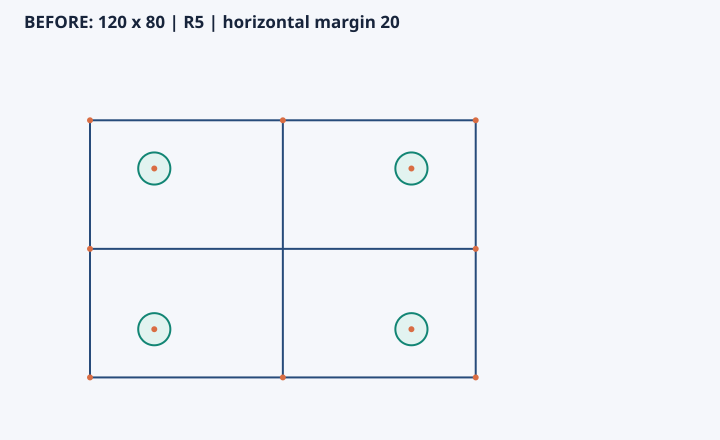
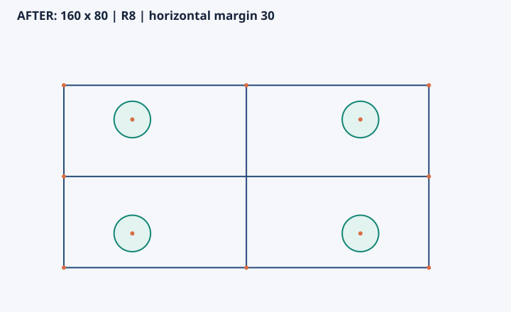
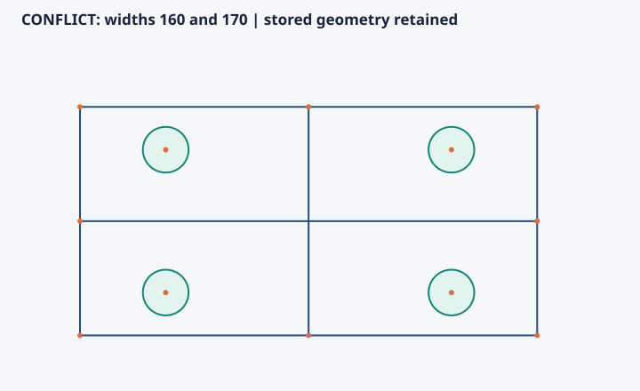

# SVG 导出

**Mooncakes 0.2.0 起提供此接口。** 使用 `moon add mik1e80/cad_sketch` 安装；已使用旧版本的项目可运行 `moon add mik1e80/cad_sketch --upgrade`。核心导出逻辑为纯 MoonBit，不需要 Node.js、Python、浏览器或绘图库。

## 导出字符串

```moonbit
match sketch.to_svg() {
  Ok(svg) => println(svg)
  Err(error) => println(error.message())
}
```

`Sketch::to_svg(options~ : SvgOptions = SvgOptions::default()) -> Result[String,SketchError]` 返回独立 SVG 字符串。宿主应用负责保存文件或显示字符串，库本身没有文件 I/O。

它绘制草图当前保存的点、线段和圆，不运行求解、不修改几何。导出前沿用正常的几何、资源和启用约束定义校验，错误继续使用 `SketchError`；禁用关系跳过关系校验。相互矛盾但定义合法的关系可以导出，图中仍是保存几何。

## 选项与共享比例

```moonbit
let options = {
  ..@sketch.SvgOptions::default(),
  title: "After editing dimensions",
  show_points: false,
  bounds: Some({ min_x: -12.0, min_y: -12.0, max_x: 180.0, max_y: 100.0 }),
}
let svg = sketch.to_svg(options~)
```

| 字段 | 默认值 | 语义 |
| --- | --- | --- |
| `width` / `height` | 720 / 440 | 输出像素尺寸；宽 64..4096，高 96..4096 |
| `padding` | 24 | 至少 4 像素；画布还需容纳 32 像素标题区 |
| `title` | CAD sketch | 同时用于可访问标题和可见文字；XML 特殊字符转义，非法 XML 字符替换 |
| `show_points` | true | 是否显示固定像素大小的点标记 |
| `bounds` | None | 自动适配所有几何；可传 `SvgBounds` 固定共同视野 |

`SvgBounds` 由 `min_x`、`min_y`、`max_x`、`max_y` 四个世界坐标组成，须有限、有序并包含全部几何（包括完整圆）。非法画布或范围返回 `InvalidOptions`。

世界坐标保持 X 向右、Y 向上；导出时映射到 SVG 的屏幕坐标。两个方向使用同一比例，圆保持圆形，线按两个端点画成有限线段。空草图可以导出。多幅图使用相同尺寸、边距和 `bounds`，即可比较同一比例下的实际变化。

## 修改前、修改后和冲突

安装板示例的六条 JSON 记录新增 `svg` 字符串字段，由 `Sketch::to_svg()` 直接产生。以下三个文件分别取自 `initial`、`edited`、`conflict` 阶段；Python 仅运行示例、核对 XML 并写出原字符串，不绘制几何。

| 修改前：120×80、R5、水平边距 20 | 修改后：160×80、R8、水平边距 30 |
| --- | --- |
|  |  |

冲突阶段同时要求板宽 160 和 170。求解报告未达标，保存几何与修改后完全相同：



文件链接：[before.svg](images/svg-export/before.svg)、[after.svg](images/svg-export/after.svg)、[conflict.svg](images/svg-export/conflict.svg)。冲突图不是未应用候选几何的可视化，也不以图片证明无解；关系误差请读取原始求解报告。

## 生成和轻量检查

在源码仓库根目录执行，需要 Python 3.10+ 标准库与 MoonBit：

```sh
python scripts/export_svg.py --write
python scripts/export_svg.py --check
moon test svg_test.mbt --target js
```

生成脚本只运行安装板的六个阶段，检查每张图的 6 条线、4 个圆、12 个点，以及独立换算的坐标与半径。它还检查冲突前后保存几何完全一致、SVG 几何完全一致，并验证篡改圆半径会被检查器拒绝。原始事件保存于 `_build/svg-export/events.json`。

`--write` 更新三份文件，默认或 `--check` 对照已提交文件且不覆盖。单元检查覆盖坐标方向、统一比例、点标记、空图、非法选项、输入错误、XML 转义、极端数值及冲突保留；本次没有运行全量回归或后端矩阵。
